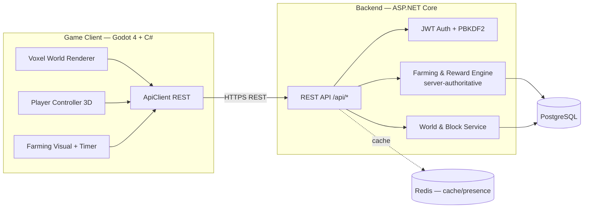

# GrowCraft 3D — Arsitektur

> Sesuai master prompt: hybrid Java × Bedrock inspired, server-authoritative, modular & data-driven.

## Diagram alur



## Prinsip kunci

1. **Server-authoritative** — waktu pertumbuhan memakai `planted_at` UTC di PostgreSQL.
   Tanaman **tetap tumbuh saat pemain offline**; client hanya menampilkan sisa waktu.
2. **Reward selalu seed + gem** — dihitung server dari `seed_definitions` +
   bonus level (3%/lvl) + bonus air (≥60% → +25%). Tidak ada hadiah dari client.
3. **Data-driven** — balancing ada di `content/behavior_packs/economy/harvest_config.json`
   dan tabel `seed_definitions`, bisa di-tune tanpa rebuild.
4. **Modular monorepo** — `game-client/` (Godot), `backend/` (.NET: Domain / Infrastructure / API),
   `database/` (schema + seed), `content/` (behavior packs ala Bedrock).

## Struktur direktori

```
GrowCraft-3D/
├── game-client/          # Godot 4 + C# — dunia voxel, player, farming
├── backend/
│   └── src/
│       ├── GrowCraft.Domain/          # Entity murni (User, World, Plant, ...)
│       ├── GrowCraft.Infrastructure/  # EF Core DbContext (PostgreSQL, snake_case)
│       └── GrowCraft.Api/             # REST API: auth, worlds, farming, inventory
├── database/init/        # DDL + seed data (dipakai docker-compose)
├── content/
│   └── behavior_packs/economy/        # config ekonomi data-driven
├── docker-compose.yml    # postgres + redis + api
└── docs/
```

## Roadmap teknologi

| Layer | Sekarang (Phase 1) | Berikutnya |
|---|---|---|
| Client | Godot 4 C#, world 24×24×6, farming visual | Chunk 16³ + greedy meshing, world editor |
| Networking | REST (ApiClient) | ENet/UDP realtime + WebSocket chat |
| Server | ASP.NET Core REST, JWT, PBKDF2 | Dedicated game server, anti-cheat, rate-limit |
| DB | PostgreSQL (schema di `database/init`) | Snapshot chunk, Redis presence |
| Ekstensi | `content/behavior_packs` JSON | Plugin API event-listener ala Java mod |

## Menjalankan

```bash
# 1) Database + API
docker compose up -d --build
# API: http://localhost:5000 — coba: POST /api/auth/register

# 2) Game client (butuh Godot 4.x + .NET SDK)
cd game-client
godot --path .        # atau buka folder ini dari Godot editor
```
